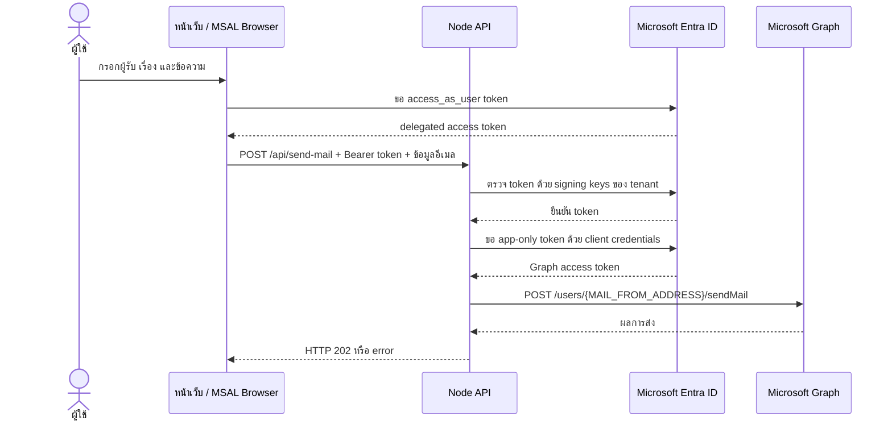

# ระบบส่งอีเมล

เอกสารนี้อธิบายการส่งอีเมลจากหน้าเว็บ Entra ID ผ่าน Node.js API และ Microsoft Graph รวมถึงไฟล์ที่เกี่ยวข้องและสิ่งที่ต้องตั้งค่าก่อนใช้งานจริง

## ภาพรวม

ระบบใช้การยืนยันตัวตนสองช่วง:

1. ผู้ใช้ลงชื่อเข้าใช้ด้วย Microsoft Entra ID ใน browser
2. หน้าเว็บขอ delegated access token สำหรับ scope `access_as_user`
3. หน้าเว็บส่งข้อมูลอีเมลและ token ไปที่ `POST /api/send-mail`
4. Node API ตรวจลายเซ็น token, tenant, client และ scope ก่อนรับคำขอ
5. Node API ใช้ client credentials ของแอปขอ app-only token จาก Microsoft Graph
6. Graph ส่งอีเมลจาก mailbox ที่กำหนดใน `MAIL_FROM_ADDRESS`



## ไฟล์ที่เกี่ยวข้อง

| ไฟล์ | หน้าที่ |
| --- | --- |
| `index.html` | ประกาศฟอร์มส่งอีเมล ได้แก่ `mail-to`, `mail-subject`, `mail-body` และปุ่ม `send-mail` รวมถึงส่วนแสดงสถานะ |
| `src/main.js` | จัดการหน้าเว็บและ MSAL; ขอ access token, ส่ง `fetch` ไป `/api/send-mail`, แสดงสถานะสำเร็จ/ผิดพลาด และล้างฟอร์มเมื่อส่งสำเร็จ |
| `src/authConfig.js` | กำหนด tenant/client ID, redirect URI, scope สำหรับอ่านโปรไฟล์ (`User.Read`) และ scope API (`api://<client-id>/access_as_user`) |
| `redirect.html` | รับ callback จาก Entra หลัง sign-in และให้ MSAL ประมวลผลผล redirect ก่อนกลับหน้าแอป |
| `server/index.js` | Node/Express API; โหลด `.env`, ตรวจ config, ตรวจ Bearer token, ตรวจข้อมูลคำขอ และเรียก Graph เพื่อส่งอีเมล |
| `.env.example` | ตัวอย่างชื่อตัวแปรที่ API ต้องใช้ ห้ามใส่ secret จริงในไฟล์ตัวอย่างนี้ |
| `.env` | ค่า runtime สำหรับ Node API รวมถึง client secret; ถูกละเว้นจาก Git ตาม `.gitignore` |
| `vite.config.js` | ระหว่างพัฒนา proxy `/api` ไป `http://127.0.0.1:3000`; กำหนดหน้า HTML ที่ Vite build |
| `package.json` / `package-lock.json` | dependencies และคำสั่งติดตั้ง, รัน development server และ build |
| `ops/p2027-nginx.conf` | ตัวอย่าง Nginx สำหรับ HTTPS, static files และ proxy `/api/` ไปยัง Node API บน `127.0.0.1:3000`; ต้องติดตั้ง config นี้บน host และ reload Nginx จึงมีผล |
| `README.md` | ขั้นตอนตั้งค่า Entra app, Exchange RBAC, การพัฒนาและ deployment |

## การทำงานในโค้ด

### ลงชื่อเข้าใช้และ callback

1. ตอนเริ่มหน้า `src/main.js` เรียก `msalInstance.initialize()` และ `handleRedirectPromise()` เพื่อตรวจผลตอบกลับจาก Entra
2. เมื่อผู้ใช้กดปุ่มลงชื่อเข้าใช้ หน้าเว็บเรียก `loginRedirect(loginRequest)` โดยขอ `User.Read`
3. Entra ส่ง browser กลับ URI ใน `src/authConfig.js` ซึ่งลงท้ายด้วย `redirect.html`
4. `redirect.html` เริ่ม MSAL อีกครั้งและเรียก `handleRedirectPromise()` เพื่อประมวลผล callback จากนั้นเปลี่ยนเส้นทางกลับไปยัง base URL ของแอป
5. หน้าแอปอ่านบัญชีจาก MSAL cache และใช้ `acquireTokenSilent()` เพื่อเรียก Microsoft Graph หรือ API; ถ้าต้องให้ผู้ใช้ยืนยันเพิ่ม จึงใช้ `acquireTokenPopup()`

### ฝั่ง Browser

หลังผู้ใช้ลงชื่อเข้าใช้ `src/main.js` จะใช้บัญชี MSAL ที่ active และแสดงเมนูส่งอีเมล เมื่อ submit ฟอร์ม โค้ดจะเรียก `getAccessToken(account, mailApiRequest)`:

- ขอ token แบบ silent ก่อน
- ถ้าต้องมี interaction เพิ่ม จะใช้ MSAL popup เพื่อขอ token
- ส่ง `POST /api/send-mail` พร้อม header `Authorization: Bearer <access-token>` และ JSON body:

```json
{
  "to": "recipient@example.com",
  "subject": "หัวข้ออีเมล",
  "message": "ข้อความอีเมล"
}
```

เมื่อ API ตอบสำเร็จ หน้าเว็บล้างฟอร์มและแสดงข้อความว่าส่งแล้ว ถ้าล้มเหลวจะแสดงข้อความ error จาก API โดยไม่ถือว่าการตอบรับคำขอเท่ากับผู้รับเปิดอ่านอีเมล

### ฝั่ง Node API

`server/index.js` โหลด `.env` จาก root ของโปรเจกต์เมื่อเริ่มทำงาน และหยุดเริ่ม API หากไม่มีตัวแปรที่จำเป็น: `ENTRA_TENANT_ID`, `ENTRA_CLIENT_ID`, `ENTRA_CLIENT_SECRET` หรือ `MAIL_FROM_ADDRESS`.

Middleware `authenticateUser` ทำงานก่อน route ส่งอีเมล:

- รับ token จาก Bearer authorization header
- ตรวจ issuer และลายเซ็นด้วย Microsoft signing keys สำหรับ token issuer ที่รองรับ
- ตรวจ audience, tenant ID, client ID และ delegated scope `access_as_user`
- ตอบ `401` เมื่อไม่มี token หรือ token ไม่ถูกต้อง และ `403` เมื่อ token มาจาก tenant/client ผิดหรือไม่มี scope ที่ต้องการ

Route ตรวจข้อมูลก่อนเรียก Graph:

| ฟิลด์ | เงื่อนไข |
| --- | --- |
| `to` | ต้องเป็นอีเมลที่รูปแบบถูกต้อง ยาวไม่เกิน 254 ตัวอักษร |
| `subject` | ต้องไม่ว่างหลัง trim และยาวไม่เกิน 255 ตัวอักษร |
| `message` | ต้องไม่ว่างหลัง trim และยาวไม่เกิน 10,000 ตัวอักษร |

ถ้าข้อมูลไม่ผ่าน API ตอบ `400` จากนั้น API ขอ app-only token ด้วย scope `https://graph.microsoft.com/.default` และส่ง `POST https://graph.microsoft.com/v1.0/users/{MAIL_FROM_ADDRESS}/sendMail` โดยกำหนด body เป็น plain text และ `saveToSentItems: true` สำเร็จแล้วตอบ `202` หาก Graph หรือ credential มีปัญหา API ตอบ `502`.

| HTTP status | ความหมาย |
| --- | --- |
| `202 Accepted` | Microsoft Graph รับคำขอส่งเมลแล้ว ไม่ใช่หลักฐานว่าผู้รับได้รับหรือเปิดอ่านแล้ว |
| `400 Bad Request` | รูปแบบหรือความยาวของผู้รับ เรื่อง หรือข้อความไม่ผ่าน validation |
| `401 Unauthorized` | ไม่มี Bearer token หรือ token ตรวจสอบไม่ได้/หมดอายุ |
| `403 Forbidden` | token ใช้ได้แต่ tenant, client หรือ scope ไม่ตรงกับ API |
| `502 Bad Gateway` | Graph ปฏิเสธคำขอ หรือ API ติดต่อ Graph/ขอ token ไม่สำเร็จ |

## การตั้งค่าก่อนใช้งาน

1. ใช้ Node.js `22.12` ขึ้นไป แล้วติดตั้ง dependencies ด้วย `npm install`.
2. สร้าง `.env` จาก `.env.example` และกำหนดค่าจริงให้ครบ:

  ```dotenv
   ENTRA_TENANT_ID=<tenant-id>
   ENTRA_CLIENT_ID=<application-client-id>
   ENTRA_CLIENT_SECRET=<server-side-secret>
   MAIL_FROM_ADDRESS=<sender-mailbox>
  # Optional; defaults to 3000
  PORT=3000
   ```

   ค่า tenant/client ต้องตรงกับ `src/authConfig.js`; `MAIL_FROM_ADDRESS` คือ mailbox ผู้ส่งคงที่ ไม่ใช่ค่าจากฟอร์ม
3. ใน Entra app registration เปิด **Expose an API**, ตั้ง Application ID URI เป็น `api://<application-client-id>` และสร้าง delegated scope ชื่อ `access_as_user`.
4. เพิ่ม delegated permission `User.Read` และ scope `access_as_user` ให้ client app พร้อม grant consent ตามนโยบาย tenant
5. ใน **Authentication**, ลงทะเบียน redirect URI ของแต่ละ environment เป็นชนิด **Single-page application** ให้ตรงทั้งหมด เช่น `http://localhost:5173/redirect.html` และ `https://netentra.citcoms.up.ac.th/redirect.html`.
6. ใน Exchange Online กำหนด Exchange RBAC role `Application Mail.Send` ให้ service principal ของแอป โดย management scope ต้องจำกัด mailbox ที่อนุญาตให้ส่ง ตรวจสอบด้วย `Test-ServicePrincipalAuthorization`.
7. ห้ามให้แอปมี Microsoft Graph **Application** permission `Mail.Send` แบบไม่จำกัด scope เพิ่มเติม เพราะสิทธิ์จะถูกรวมกันและอาจทำให้ Exchange RBAC ไม่ได้จำกัด mailbox ตามที่ตั้งใจ

## การรันและ deployment

รันทั้ง Vite และ Node API ใน development:

```bash
npm install
npm run dev
```

Vite แสดงหน้าเว็บที่ `http://localhost:5173/` และ proxy `/api` ไป Node API ที่ port `3000`. คำสั่ง build `npm run build` สร้าง static frontend เท่านั้น ไม่ได้ติดตั้งหรือเปิด production Node API.

Production ต้องมี Node API ที่อ่าน secret จาก `.env` หรือ secret store และมี Nginx proxy `/api/` ไป Node API พร้อมคง path เดิม ตัวอย่าง location ที่ต้องอยู่ใน HTTPS server block:

```nginx
location /api/ {
    proxy_pass http://127.0.0.1:3000;
    proxy_set_header Host $host;
    proxy_set_header X-Forwarded-For $proxy_add_x_forwarded_for;
}
```

ข้อควรตรวจ: การเพิ่ม location ใน `ops/p2027-nginx.conf` เป็นเพียงการเตรียม reverse proxy; ต้องติดตั้งไฟล์ config บน production host, ตรวจ config ด้วย `nginx -t` ในบริบทของ Nginx จริง แล้ว reload Nginx. Node API ต้องทำงานและรับ connection ที่ `127.0.0.1:3000` ด้วย. ขั้นตอน deploy ที่อธิบายใน `README.md` เผยแพร่ `dist/` เท่านั้น ไม่ได้ติดตั้ง `server/index.js`, dependencies, `.env` หรือ systemd unit สำหรับ API จึงต้อง provision API แยกต่างหาก. ปัจจุบัน API bind ที่ `0.0.0.0`; ใน production ควรจำกัด port `3000` ด้วย firewall หรือปรับให้รับเฉพาะ loopback เมื่อวางหลัง Nginx.

GitHub Pages ให้บริการได้เฉพาะ static frontend ไม่ได้รัน Node API. การส่งอีเมลจาก GitHub Pages ต้องมี API ที่เข้าถึงได้และตั้งค่า origin/token audience ให้เหมาะสม ไม่สามารถอาศัย Vite development proxy ได้

## ความปลอดภัยและขอบเขต

- เก็บ `ENTRA_CLIENT_SECRET` ไว้ฝั่ง server เท่านั้น ห้ามใช้ตัวแปร `VITE_*`, ฝังใน HTML/JavaScript หรือ commit `.env`.
- ผู้ใช้ใน tenant ที่มีสิทธิ์เรียก scope `access_as_user` สามารถส่งถึงอีเมลผู้รับที่กรอกได้; โค้ดปัจจุบันไม่มี recipient allowlist หรือ rate limit.
- Exchange RBAC จำกัด mailbox ผู้ส่ง ไม่ได้จำกัดว่าผู้ใช้คนใดใน tenant เรียก API ได้
- ค่า `MAIL_TITLE` หากมีใน `.env` ไม่ถูกอ่านโดย API ปัจจุบัน; ชื่อเรื่องมาจากฟิลด์ `subject` ในฟอร์ม
- API log ไม่บันทึก client secret หรือ access token แต่บันทึก HTTP status ของ Graph และข้อความ error ฝั่ง server

## แนวทางตรวจปัญหา

| อาการ | จุดตรวจ |
| --- | --- |
| `AADSTS50011` | redirect URI ใน request ต้องตรงกับ **Single-page application** redirect URI ที่ลงทะเบียน รวม protocol, host, port และ path |
| API ตอบ `401` | ตรวจว่า browser ส่ง Bearer token, token ยังไม่หมดอายุ และ issuer/signature ถูกต้อง |
| API ตอบ `403` | ตรวจ tenant/client ID และ delegated scope `access_as_user` ใน token |
| API ตอบ `400` | ตรวจรูปแบบอีเมลผู้รับ, เรื่อง และข้อความ รวมความยาวตามตารางด้านบน |
| API ตอบ `502` | ตรวจ `.env`, client secret, Graph app token และ Exchange RBAC authorization สำหรับ sender mailbox |
| หน้าเว็บใช้ได้แต่ส่งเมลไม่ได้ใน production | ตรวจว่า Node API ทำงานและ Nginx proxy `/api/` ไป port `3000` |

การทดสอบ end-to-end ควรลงชื่อเข้าใช้ด้วยบัญชีที่ได้รับอนุญาต ส่งอีเมลทดสอบไปยัง mailbox ที่ควบคุมได้ และตรวจทั้ง response ในหน้าเว็บกับรายการ Sent Items ของ mailbox ผู้ส่ง